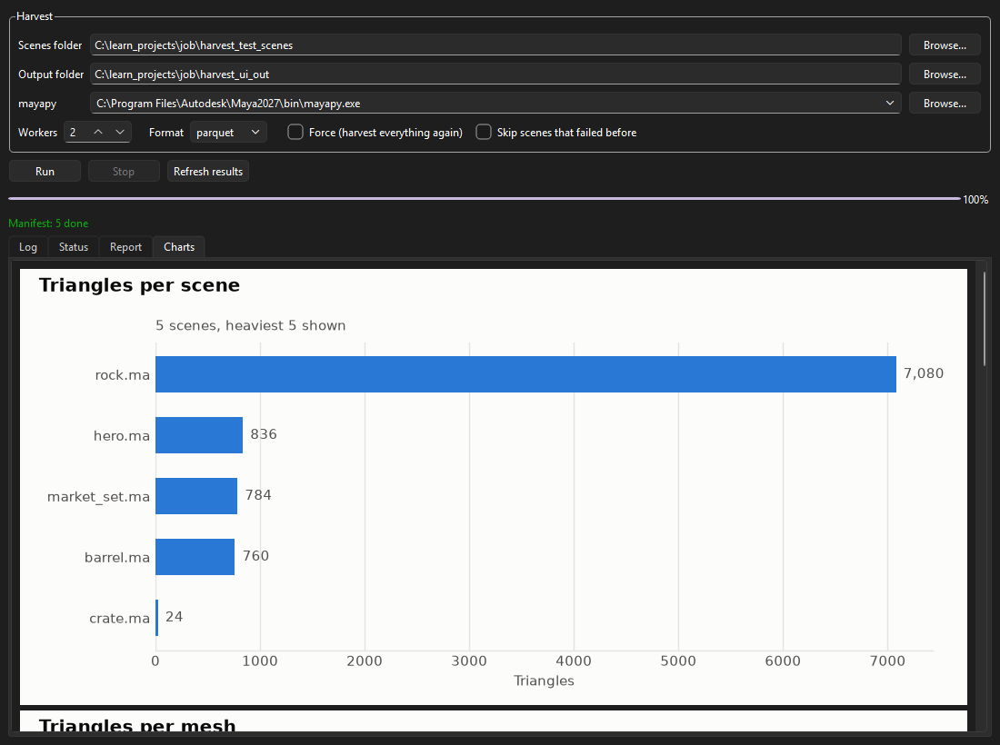

# scene_harvest

Opens a folder of Maya (or USD) scenes in the background and saves what's
inside them as tables you can load in pandas.



I wanted to answer simple questions about a scene library without opening
every file by hand. How heavy are these assets, which textures are missing,
how many influences do the skins use. So this opens each scene in `mayapy`,
pulls out meshes, hierarchy, materials, skinning and file dependencies, and
writes it all to Parquet.

## Running it

On Windows, double-click `launch_ui.bat`. The first run builds its own
Python environment, which needs a 64-bit Python 3.10 to 3.13 installed.
After that it just opens the window. On Linux or macOS use `./launch_ui.sh`.

Pick the scene folder and a results folder, check the mayapy path (it finds
installed Maya versions itself) and press Run. The Status, Report and Charts
tabs fill in when it's done.

From a terminal it's the same thing:

```bash
pip install -e ".[ui]"

scene-harvest run D:/library -o D:/harvest -w 4 --mayapy "C:/Program Files/Autodesk/Maya2027/bin/mayapy.exe"
scene-harvest report -o D:/harvest
```

`scene-harvest plan` shows what a run would do without opening anything,
and `--force` harvests everything again. You can set `SCENE_HARVEST_MAYAPY`
instead of passing `--mayapy`. For USD scenes install `.[ui,usd]`.

## The data

Results land in `<output>/dataset/` as one Parquet table each for scenes,
nodes, meshes, materials, dependencies, skeletons and skins.

```python
from scene_harvest import writers

meshes = writers.read_table("D:/harvest", "meshes")
meshes.groupby("scene_id")["triangle_count"].sum()
```

`notebooks/analysis.ipynb` has a few more examples.

I also wanted the output to be safe to train on. Every row has a `scene_id`
built from the scene's absolute path, so it's the same on every run and
joins all the tables. The `scenes` table keeps a SHA-256 of each file, so
you know which version of a scene a row came from. Only scenes whose harvest
finished make it into the dataset; a crashed or half-done scene is left out
rather than written as partial rows. If you bump a collector's `version`,
the next run re-harvests every scene for that host, so old and new
extraction code don't end up mixed. Reruns only redo scenes that changed,
and scenes deleted from the folder are dropped.

## How it works

Scenes are split into batches and each batch runs in its own `mayapy`
process, which writes one small file per scene plus a "done" marker, so a
crash costs at most the scene that was open. The main process then merges
everything into Parquet, since stock Maya doesn't ship pyarrow.

To collect something new, subclass `registry.Collector` and list its module
in `SCENE_HARVEST_PLUGINS`.

## Tests

```bash
python -m pytest     # everything except the Maya collectors
mayapy -m pytest     # adds the Maya collector tests
```

## License

MIT, see `LICENSE`.
